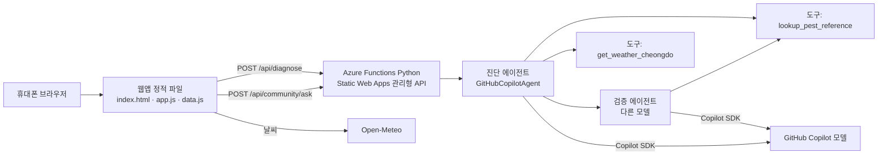

# TRD: 미나리 — 청도 농가 코파일럿

> 2026-11-05 기준. 이 문서에는 저장소에 있는 코드만 적는다.

## 1. 구조



| 구성 | 파일 | 기술 |
|---|---|---|
| 웹앱 | `index.html`, `app.js`, `data.js`, `styles.css` | 빌드 없는 ES 모듈, 반응형 |
| API | `api/function_app.py` | Azure Functions Python v2 |
| 에이전트 | `api/agents.py` | `agent-framework-core` 1.24, `agent-framework-github-copilot` 2.1.1, `github-copilot-sdk` 1.0.28 |
| 배포 | `.github/workflows/azure-static-web-apps-*.yml`, `staticwebapp.config.json` | Azure Static Web Apps, GitHub Actions |
| 테스트 | `tests/e2e_qa.py` | Playwright 10개 시나리오 |

## 2. 에이전트 설계

| 에이전트 | 모델 (환경 변수) | 도구 | 역할 |
|---|---|---|---|
| diagnosis | `DIAG_MODEL` (기본 gpt-5) | `lookup_pest_reference`, `get_weather_cheongdo` | 증상·사진 색 분석·날씨로 후보 최대 3개, 확신, 근거 |
| judge | `JUDGE_MODEL` (기본 claude-sonnet-4) | `lookup_pest_reference` | 진단 결과를 도구 결과와 비교해 근거 없는 후보를 빼고 확신을 낮춤 |
| community | `DIAG_MODEL` | 없음 (요청에 글 목록 포함) | 질문과 관련된 글 최대 3개, 원문 문장 인용 |

- **패턴:** 진단 → 검증 순서 실행(Sequential, 작성자↔검토자).
- **도구 호출:** Agent Framework `@tool` 함수 도구를 Copilot SDK 세션 도구로 넘긴다.
- **출력 형식:** 에이전트는 JSON만 출력한다. 서버가 형식을 검사한다.
- **환각 방지:** 서버는 도감에 있는 병해충 이름만 남기고, 확신 값은 세 가지 중 하나로 고정한다. 커뮤니티 인용은 원문에 그대로 있는 문장만 남긴다.
- **스트리밍:** 지금은 단계 진행 표시만 한다. 응답 스트리밍은 다음 단계.

## 3. API

| 경로 | 입력 | 출력 |
|---|---|---|
| `GET /api/health` | — | `{ok, agent, models}` |
| `POST /api/diagnose` | `{crop, symptoms[], stats}` | `{top[{p, conf, ev[]}], dropped[], hard, source:"agent", models}` |
| `POST /api/community/ask` | `{question, posts[{id,title,body}]}` | `{items[{id, quote}], source:"agent"}` |

- 요청 본문 3MB 제한, 입력 길이 자르기, 실패 시 503.
- 503이면 웹앱이 같은 형식의 결과를 앱 안 규칙으로 만들고 "에이전트 연결 전"을 표시한다.

## 4. 데이터 저장

- 기록, 일정, 커뮤니티 글은 브라우저 `localStorage`에 저장한다(기기별). 저장소를 쓸 수 없으면 화면은 그대로 동작하고 저장만 안 된다.
- 사진은 기본으로 저장하지 않는다. 저장을 고르면 캔버스로 다시 그려 위치 정보(EXIF)를 지운 JPEG로 저장한다.

## 5. 배포

1. `main`에 푸시하거나 PR을 열면 GitHub Actions가 Static Web Apps로 웹앱(`/`)과 API(`api/`)를 배포한다. PR마다 미리보기 주소가 생긴다.
2. Azure Portal → Static Web App → 환경 변수에 넣는다:
   - `COPILOT_GITHUB_TOKEN`: Copilot을 쓸 수 있는 GitHub 토큰 (저장소에 넣지 않는다)
   - 선택: `DIAG_MODEL`, `JUDGE_MODEL`, `AGENT_TIMEOUT`
   - 선택: `APPLICATIONINSIGHTS_CONNECTION_STRING` (Functions 로그·실패를 Application Insights로 보냄)
3. `GET /api/health`의 `agent`가 `true`인지 확인한다.

Copilot SDK는 처음 실행할 때 Copilot CLI를 `/tmp/copilot-cli`에 내려받는다. 첫 요청이 느릴 수 있다.

## 6. 보안·책임 있는 AI

- 결과에 "AI 추정"과 에이전트·모델 이름 표시
- 약제명·희석 배수·살포량을 만들지 않도록 지시, 등록 약제는 농약안전정보시스템 링크로 안내
- 사용자 입력과 글 안의 지시는 데이터로만 다룬다는 인스트럭션
- 전화번호·주민등록번호 자동 가림, 모든 사용자 입력은 화면에 넣을 때 HTML 이스케이프
- 비밀값은 Azure 환경 변수에만 둔다

## 7. 테스트

Python 3.10 이상이 필요하다. 첫 번째 터미널에서 서버를 실행하고, 두 번째 터미널에서 테스트를 실행한다. GitHub Actions도 배포 전에 이 테스트를 실행한다.

```
python3.10 -m pip install playwright pillow
python3.10 -m playwright install chromium
python3.10 -m http.server 8765
```

```
python3.10 tests/e2e_qa.py
```

10개 시나리오: 휴대폰 첫 방문, 실시간 날씨, 감 탄저병 진단, 흐린 사진, 미나리 진딧물·사진 저장, 기록→일정, 농기계 임대, 커뮤니티 보안, 저장소 막힘, 데스크톱·다크 모드·접근성. 에이전트 응답 형식(`source: "agent"`) 표시도 확인한다.
